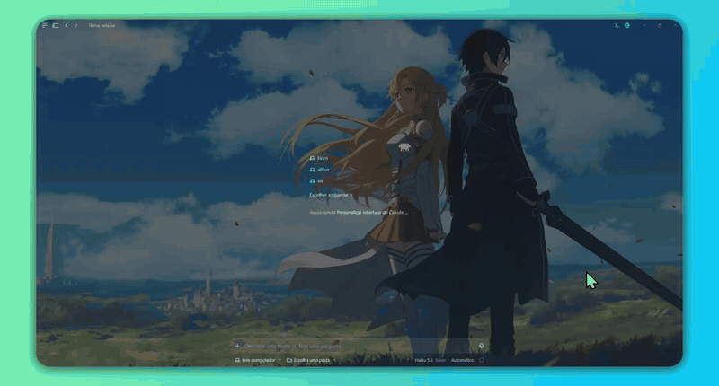

# Live Backdrop

Your desktop wallpaper, live, behind the Claude desktop app on Windows. Animated wallpapers from
[Wallpaper Engine](https://www.wallpaperengine.io/) keep moving, or pick any picture instead.
A `/backdrop` panel inside Claude sets it up.

> **Unofficial.** Live Backdrop is a community project. It is not made, endorsed or supported
> by Anthropic. "Claude" is a trademark of Anthropic, used here only to say what this works with.



## How it looks

A faint copy of whatever is on your desktop sits over the Claude window, as if the window were
tinted glass. It follows the window as you move or resize it, minimizes with it, and lets every
click and keystroke through to Claude.

## Requirements

- Windows 10 version 2004 or later, or Windows 11
- The [Claude desktop app](https://claude.ai/download)
- For animated wallpapers: Wallpaper Engine, with **Settings → Performance → Other application
  maximized** set to **Keep running** (by default it pauses while any window is maximized)

## Install

**1. The overlay.** Download `LiveBackdrop-win-x64.zip` from the
[latest release](https://github.com/marcossimo/live-backdrop/releases/latest), extract it
anywhere you keep programs (for example `%LOCALAPPDATA%\Programs\LiveBackdrop`) and run
`LiveBackdrop.exe` once. It records where it lives, so the plugin can start it later.

The release is not code-signed yet, so Windows SmartScreen may warn on the first run
(**More info → Run anyway**). You can also [build it yourself](#build-from-source).

**2. The plugin.** In a Claude Code terminal session:

```
/plugin install live-backdrop --marketplace marcossimo/live-backdrop
```

Or from a shell:

```
claude plugin install live-backdrop --marketplace marcossimo/live-backdrop
```

In the desktop app: click **+** next to the prompt box, then **Plugins**, **Add marketplace**
with `marcossimo/live-backdrop`, then **Add plugin**.

## Use

| Command | What it does |
| --- | --- |
| `/backdrop` | Opens the settings panel |
| `/backdrop on` | Turns the backdrop on (starting the overlay if needed) |
| `/backdrop off` | Turns it off |

The panel sets the source (live wallpaper or a picture file), the opacity, the blur, and
whether the overlay starts with Windows. Changes apply immediately.

**Blur** softens the picture so text stays easy to read, like frosted glass. *Behind text*
(the default) blurs it only behind what the app draws, paragraph by paragraph, and follows the
chat as you scroll, leaving empty space sharp; *Everywhere* blurs the whole layer.

**Keep web pages clear** (on by default) leaves the built-in browser panel, and other web
pages embedded in the app, without any backdrop.

**Colors** (all off by default):

- *Your messages*: the bubble and the text colour of what you send.
- *Claude's replies*: a background behind each reply, at the opacity you choose. The text of
  replies keeps the app's colour: replies are rich text (headings, lists, code), which plugins
  can wrap but not recolour.

Message colours are drawn by the app itself through the plugin, so they scroll with the chat.
While your bubble colours are on, pictures attached to your messages are not shown in the
bubble; turn the bubble colour off to see them again.

Settings live in `%LOCALAPPDATA%\LiveBackdrop\settings.json`; you can edit that file by hand
too, and the overlay picks the change up within a frame.

## How it works

Windows keeps the desktop wallpaper, Wallpaper Engine's included, in a window called
"Program Manager". The overlay reads that window with
[Windows Graphics Capture](https://learn.microsoft.com/windows/uwp/audio-video-camera/screen-capture)
on the GPU (it sees the wallpaper even where windows cover it), crops the part under the Claude
window and shows it in its own transparent, click-through window placed just above Claude,
through DirectComposition with the opacity you chose. New frames arrive at the wallpaper's own
frame rate.

To blur only behind text, the overlay also captures the Claude window itself (the same way)
and finds where it draws letters and icons by their edges, on the GPU. To keep web pages clear,
it asks Windows (UI Automation) where the app shows an embedded page, by accessibility role.
Nothing is stored, nothing is read from other windows, and nothing leaves your computer.

The Claude app itself has no setting for a custom background, which is why the picture sits
*over* the window. A side effect: at higher opacity it also tints the text. Around 15–25 % is a
good range. See [docs/ARCHITECTURE.md](docs/ARCHITECTURE.md) for the details and the
alternatives that were ruled out.

## Troubleshooting

- **Nothing shows.** Run `/backdrop` and check the status line. The overlay writes a log to
  `%LOCALAPPDATA%\LiveBackdrop\overlay.log`.
- **The animation stops when Claude is maximized.** That is Wallpaper Engine pausing; see
  [Requirements](#requirements).
- **"Overlay not installed yet".** Run `LiveBackdrop.exe` once so it can record its location.

## Build from source

You need the [.NET 8 SDK](https://dotnet.microsoft.com/download/dotnet/8.0).

```
dotnet test overlay/LiveBackdrop.sln
dotnet publish overlay/src/LiveBackdrop.csproj -c Release -r win-x64 --self-contained -o publish
```

To work on the plugin, run Claude Code with this folder as a plugin directory:

```
claude --plugin-dir .
```

and check it with `claude plugin validate .` and `claude plugin test .`.

## Roadmap

Ideas, roughly in order. Discussion and pull requests are welcome.

- A code-signed release
- More settings in the panel, such as a frame-rate cap
- A picture slideshow from a folder
- Following other apps besides Claude
- A true background (behind the text) if the Claude app ever offers one to plugins

## Contributing

See [CONTRIBUTING.md](CONTRIBUTING.md). Please read the [code of conduct](CODE_OF_CONDUCT.md)
first, and report security issues as described in [SECURITY.md](SECURITY.md).

## License

[MIT](LICENSE)
